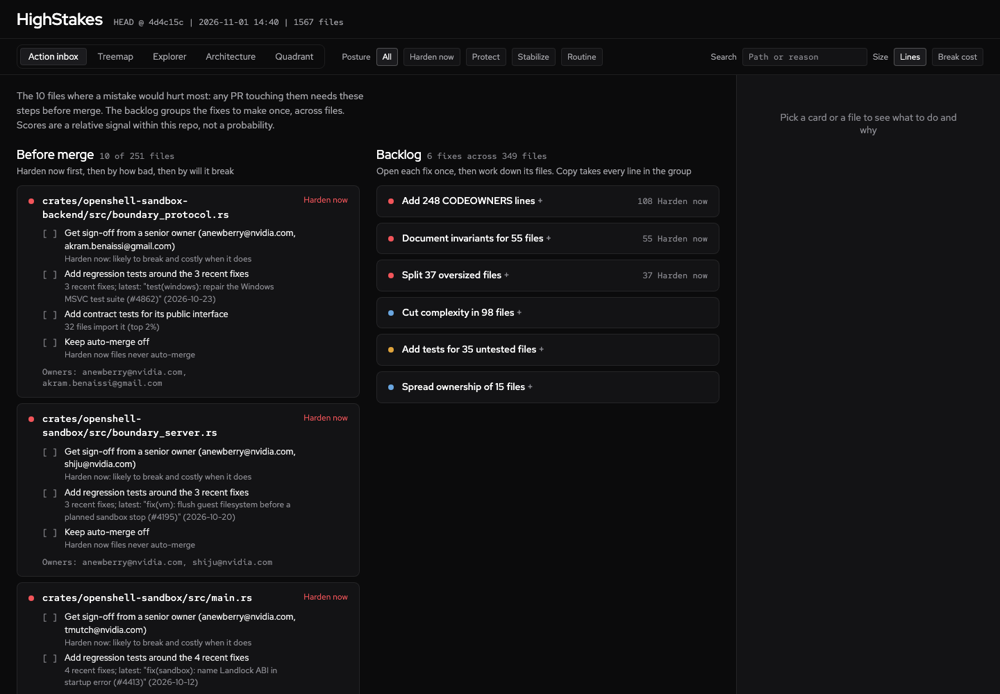

<p align="center">
  <br>
  
  <br>
  <em>AI writes code faster than you can review it. See where you're needed and where AI can handle the rest.</em>
  <br>
  <br>
</p>

<h1 align="center">HighStakes</h1>

<p align="center">
  <strong>Know which code would hurt the most if it broke.</strong>
  <br>
  LLM-assisted blast radius analysis for every file in your repo.
  <br>
  <br>
  <a href="#quick-start">Quick Start</a> ·
  <a href="#how-it-works">How It Works</a> ·
  <a href="#commands">Commands</a> ·
  <a href="#models">Models</a>
</p>

Point it at any codebase. In under 2 minutes, you know:

- **Where to focus**: "sandbox.py handles isolation. Breakage causes container escapes." (Harden now)
- **What's safe**: "theme.rs sets terminal colors. Breakage causes cosmetic issues." (Routine)
- **What to do**: a checklist for the next merge (owner sign-off, regression tests, no auto-merge) and backlog items with a copyable command

Static analysis alone can't do this. A complexity counter sees `auth.rs` and `theme.rs` as "both Rust files." The LLM reads the code and understands that one is a security boundary and the other formats colors.

Every file gets two scores, because they answer different questions:

- **Will it break?** How likely the file is to need fixes (churn, complexity, centrality, incidents). JSON: `likelihood`. Validated on bug-fix history: on a merged-PR calibration over 7 repos, its top 10 files caught later bug-fix PRs with precision 0.57 to 1.00 (lift 2.2 to 4.4).
- **How bad if it breaks?** What breaks if the file has a bug (LLM blast radius). JSON: `impact`. AI-assessed and not yet checked against maintainer ratings: on the same calibration it was positive but weaker than plain PR activity in 5 of 7 repos.

Each score is shown with its repo cutoff (top 20% of the repo; for "How bad", at least 61), because scores are a relative signal within the repo, not a probability. Together they give each file a posture, the thing to do about it:

|  | Will it break? low | Will it break? high |
|---|---|---|
| **How bad? high** | **Protect**: owner review, block auto-merge, tests before merge when none sit next to the file | **Harden now**: senior owner sign-off, regression and contract tests, smaller PRs, auto-merge off |
| **How bad? low** | **Routine**: normal review; agents may auto-merge (autonomy L3) | **Stabilize**: regression tests when fixes recur, refactor what you touch, a second reviewer for single-owner files; never blocks |

## Quick Start

**1.** Install and set up:

```sh
go install github.com/zanetworker/highstakes/cmd/highstakes@latest
export OPENROUTER_API_KEY="sk-or-..."
```

**2.** Analyze:

```sh
cd /path/to/repo
highstakes init && highstakes analyze
```

```
Heatmap generated: .heatmap/heatmap.json (305 files)

Heat Distribution:
  🔥🔥🔥 CRITICAL: 0 files
  🔥🔥  HIGH:     30 files
  🔥   MEDIUM:   141 files
  🟢   LOW:      134 files
```

**3.** See results:

```sh
highstakes dashboard     # Treemap, file explorer and architecture view (opens browser)
highstakes               # Terminal TUI
highstakes list --tier high
```

## Terminal TUI

Navigate the file tree with colored tier indicators. Select any file to see its posture, both questions, the before-merge and backlog checklists, and the impact dimensions.

<p align="center">
  
</p>

## Dashboard

It opens on the **Action inbox**; four investigation views sit behind tabs. One detail panel: pick a card or a file to see its verdict, both questions with their repo cutoffs (a bar with a tick at the cutoff), the before-merge and backlog checklists, and the reasons folded under **Why**.

**Action inbox**: a plan, not a list. **Before merge** has one card per Harden now or Protect file: its verdict, path, every before-merge step as a checklist (each with the signal that fired it) and its owners, Harden now first, then by how bad, then by will it break. It shows the top 10 (files tied with the tenth stay in) with **Show all** for the rest. **Backlog** has one card per kind of fix across files, such as "Add 248 CODEOWNERS lines" or "Split 37 oversized files", ordered by how many Harden now files each covers. Open a card to see its files and one **Copy** snippet with every line (all CODEOWNERS lines, sorted, or one `gh issue create` command per file). The posture filter and search apply to both. With an LLM, the inbox ranks files by their assessed posture. Without one (`--no-llm`, or no API key), files take the posture their estimated impact falls in against the repo cutoffs, and each such card says "impact estimated (run with an LLM for an assessment)", as does the inbox intro; when a run has both, LLM-assessed files come first. The dashboard is static HTML: it copies commands, it never calls GitHub.

<p align="center">
  
</p>

**Treemap**: blocks sized by code volume (or break cost), colored by posture. Your eye goes to the big red blocks first.

**Explorer**: collapsible file tree sorted hottest-first, with each file's posture and reasoning inline.

<p align="center">
  
</p>

All views respond to the posture filter (Harden now / Protect / Stabilize / Routine, one per tier), the **Agents** filter (L3 to L0, the [agent autonomy](docs/cli-reference.md#agent-autonomy) level `analyze` recorded; it filters the inbox too) and search; the treemap also has the size toggle (Lines vs Break cost). The detail panel shows each file's autonomy level, label and reason. Each posture has one colour and one shape everywhere: Harden now a red diamond, Protect an amber triangle, Stabilize a lilac square, Routine a grey circle, so only files that need attention carry colour and the views still read without colour. The URL keeps the open view (`#/arch`, `#/quadrant`, ...).

**Architecture**: one node per package (directory), laid out in dependency layers: entry points on top, foundations at the bottom. It opens grouped by runtime unit when the repo has two or more product units, else by package, fitted to the screen. Node size is total lines, colour and shape are the highest impact in the package (what breaks if it breaks), and a dashed outline with an "N likely" badge marks packages holding files likely to need fixes. Each node names its hottest file. Supporting code (docs, CI, scripts, examples, tests, benchmarks, test data, packages holding only YAML, TOML, JSON or Dockerfiles, helper bins) stays hidden until **Supporting code** is on. To keep the graph readable it draws only the 15 strongest imports plus the strongest import of each critical or high impact node, thin and grey; hover or pick a node to see all of its arrows (with their importing-file counts) while the rest fades, or turn on **All arrows**. Click a package to list its files hottest-first in the detail panel, then click a file for its blast radius. Click an arrow to see the file-level imports behind it (for example `api/src/routes.rs -> core/src/policy.rs`). Packages outside the current tier filter or search are dimmed. Wide layers wrap into rows shaped like the screen; the zoom buttons, **Fit** (whole graph on screen), mouse wheel, trackpad pinch and drag-to-pan handle large repos.

**Group by: Unit** switches the Architecture view from packages to runtime units: one box per deployable entry point (a Rust binary, a Go `main` package, a `package.json` bin or start script, a Python script), holding the components only that unit links, with shared libraries in a band below. Boxes are colored by max impact, carry the fragility marker, and show placement inferred from Dockerfiles, Helm values and Kubernetes manifests. A sandbox runtime and its supervisor built as two binaries show as two boxes, each with the libraries only it links. Click a unit for its entry point, placement evidence, components and files (both questions and posture). Supporting units (examples, scripts, helper bins) stay hidden until **Supporting code** is on, and links declared in `.heatmap/architecture.yaml` draw dashed. Units come from imports and manifests, not from a running system; see [How It Works](docs/how-it-works.md#runtime-units).

**Quadrant**: every file as a dot, "Will it break?" on x and "How bad if it breaks?" on y, with the two repo cutoffs drawn and each quadrant labelled with its posture. Dots are sized by lines and take their posture's colour and shape; hollow dots have an estimated impact (no LLM assessment, also said in the subtitle). The axes zoom to the data, always keeping the cutoffs in view; **Full scale** shows 0 to 100. Files with identical scores are spread a few pixels apart, the same way on every run. The five files that would hurt most (or, without LLM scores, the five most likely to break) are named on the plot. Hover a dot for its path, both scores and posture; click it to open the file in the detail panel.

## How It Works

1. **Static analysis** scans every source file for complexity, dependency centrality, import graph
2. **Git analysis** measures change frequency, contributor count, commit patterns
3. **LLM assessment** sends each file to an LLM: *"if this code has a bug, what breaks?"*
4. **Scoring** keeps two axes: likelihood from history and structure, impact from the LLM
5. **Tiering** places each file in the likelihood x impact quadrant and maps it to review requirements

The LLM returns structured scores across four dimensions:

| Dimension | What It Measures |
|-----------|-----------------|
| **Security** | Auth boundaries, crypto, sandbox isolation, access control |
| **Data** | PII handling, persistence, data integrity, schema |
| **Availability** | Service lifecycle, infrastructure, single points of failure |
| **User** | User-facing paths, API contracts, UX-critical flows |

### Why Two Axes

On the [calibration benchmark](bench/README.md) (seven repos, five languages), churn and complexity predicted which files needed fixes later: the ten top-ranked files on the primary repos were all fixed after the holdout cutoff. Blast radius was consistent across four LLMs but measures something else: a stable auth module can have high impact and never break. Blending it into one score at 40% made fix prediction worse for every model. So HighStakes reports both and lets the quadrant decide.

| Likelihood factor | Weight | Source |
|--------|--------|--------|
| Change Frequency | 40 | Commits in last 90 days |
| Complexity | 30 | Cyclomatic + cognitive |
| Incident History | 25 | Manual records (when present) |
| Dependency Centrality | 10 | Import graph analysis |
| Path Keywords | 5 | "auth", "payment" and similar in the path |

Impact is the highest of the four LLM dimensions. Without an LLM it is an estimate from centrality and path keywords, shown with `~`, and tiers fall back to the heat score. `heat_score` stays in the JSON: `max(likelihood, impact)` when impact is LLM-assessed, otherwise the likelihood. Details: [How It Works](docs/how-it-works.md#two-axes-likelihood-and-impact).

### Tier System

Postures are what people read. Tiers stay as machine-readable metadata (`tier` in JSON, `--tier` and `--fail-on` filters), one per posture:

| Posture | `quadrant` (JSON, unchanged) | `tier` | Heat score (without LLM) |
|------|------|-------|-----------------|
| Harden now | `fragile-critical` | `critical` | 86-100 |
| Protect | `protect` | `high` | 61-85 |
| Stabilize | `watch` | `medium` | 31-60 |
| Routine | `low` | `low` | 0-30 |

JSON keeps the `quadrant` values and adds `quadrant_label` with the posture, so existing scripts keep working.

## Commands

### Analyze

```sh
highstakes init                                         # Create .heatmap/ config
highstakes analyze                                      # Full LLM analysis (~$0.15)
highstakes analyze --model z-ai/glm-5.2                 # Different model
highstakes analyze --no-llm                             # Static only, no API key
```

### Visualize

```sh
highstakes dashboard                                    # HTML dashboard (browser)
highstakes                                              # Terminal TUI
```

### Query

```sh
highstakes get <file>                                   # Verdict, both questions, before-merge and backlog checklists
highstakes list --tier high --limit 10                  # Filter files
highstakes list --sort impact --limit 10                # Most impactful first (also: likelihood, heat)
highstakes list units                                   # Binaries and scripts, what each links, where it is packaged
highstakes list tasks                                   # Backlog items agents may take on (autonomy level 2+), with "done when"
highstakes get architecture --out arch.json             # Generated architecture diagram (SeeCode spec)
highstakes report                                       # Distribution report
```

All commands support `--json` for machine-readable output.

<details open><summary><b>Example: highstakes get</b></summary>

`get` gives the verdict, both questions with their repo cutoffs, what to do before the next merge, what to put on the backlog (with a copyable command), and why:

```
$ highstakes get crates/openshell-supervisor-network/src/proxy.rs     # NVIDIA/OpenShell, commands trimmed

crates/openshell-supervisor-network/src/proxy.rs
HARDEN NOW
Will it break?         50  HIGH  repo cutoff 35
How bad if it breaks?  92  HIGH  repo cutoff 78
Scores are a relative signal within this repo, not a probability.
Will it break? is validated on bug-fix history; How bad if it breaks? is AI-assessed, not yet checked against maintainer ratings.

Do before the next merge
  [ ] Get sign-off from a senior owner (@johntmyers, @second-owner)
      why: Harden now: likely to break and costly when it does
  [ ] Add regression tests around the 4 recent fixes
      why: 4 recent fixes; latest: "fix(network): align destination checks for direct connections (#5004)" (2026-10-28)
  [ ] Add contract tests for its public interface
      why: 11 files import it (top 7%)
  [ ] Keep auto-merge off
      why: Harden now files never auto-merge
Put on the backlog
  [ ] Split it into smaller files
      why: 479 functions in one file (top 1%)
      gh issue create --title 'Split crates/openshell-supervisor-network/src/proxy.rs' --body '...'
  [ ] Add a CODEOWNERS line
      why: not covered by CODEOWNERS
      /crates/openshell-supervisor-network/src/proxy.rs @johntmyers @second-owner
  [ ] Document its invariants
      why: 28 authors change it (top 2%)
      gh issue create --title 'Document the invariants of crates/...' --body '...'

Why
  Break signals: 55 commits in the last 90 days, 28 authors overall (top 1% of this repo); 479 functions, cyclomatic 1092 in one file (top 1%); ...
  Break cost: security 92 · availability 85 · user 85 · data 70; "Core sandbox egress proxy; bugs can block traffic or bypass network policy."
Latest fix  2026-10-28  fix(network): align destination checks for direct connections (#5004)
```

Reasons and actions are deterministic (no extra LLM call); see [How It Works](docs/how-it-works.md#reasons-and-actions) for the rules. `pr check` turns the before-merge items of the Harden now and Protect files a PR touches into one blocking checklist and ticks the ones the PR already satisfies; items for Stabilize files go into a folded "Worth doing (does not block)" section. Under the verdict, the comment says whether AI may auto-merge, with the reason (`🤖 AI may auto-merge: ❌ no (touches Protect files)`), from the [autonomy levels](docs/cli-reference.md#agent-autonomy). The dashboard and TUI detail panels show the same sections.

</details>

<details><summary><b>Example: highstakes list --sort impact</b></summary>

```
$ highstakes list --sort impact --limit 5        # hono

🔥🔥🔥  92  L  35  I  92  src/middleware/jwk/jwk.ts           JWT authentication failures can block protected routes ...
🔥🔥🔥  92  L  30  I  92  src/utils/jwt/jws.ts                JWS signing and verification failures disrupt JWT issuance ...
🔥🔥🔥  92  L  37  I  92  src/utils/jwt/jwt.ts                JWT signing and verification failures can disrupt authentication ...
🔥🔥🔥  90  L  35  I  90  src/middleware/basic-auth/index.ts  Broken checks can deny access or expose routes ...
🔥🔥   90  L   2  I  90  src/middleware/jwt/index.ts         JWT middleware exports and context typing may fail ...
```

Columns: tier, heat, `L` likelihood, `I` impact (`I~` is an estimate without the LLM). The last row is stable (likelihood 2) but impactful, so it is HIGH (protect), not CRITICAL.

</details>

### Tour

A reading path for newcomers, auditors and agents learning the codebase. The most important product code comes first (highest impact, then the most Harden now files), and whatever it depends on is read just before it. Examples, scripts, CI, deployment manifests, docs, tests, benchmarks, test data and vendored code are supporting components: hidden by default, shown in a final part with `--include-supporting`. Each stop has a `file:line` anchor at the first top-level declaration, its verdict, both questions with the repo cutoffs, why it matters, the top before-merge and backlog action (LLM critical reason or summary, else static signals), what it depends on, what uses it, and owners from recent commits and annotations. No LLM calls.

```sh
highstakes get tour --per-component 1 --min-impact 85   # 1 file per crate/package/module, only files with impact 85+
highstakes get tour --per-component 2 --include-supporting  # Add examples, scripts, CI and deploy in a final part
highstakes get tour --limit 10                          # 10 most impactful files repo-wide
highstakes get tour --focus internal/llm                # One directory
highstakes get tour --json > tour.json                  # Feed /show-me walkthrough or an agent
```

A component is a Rust crate, JS/TS package, Python package or Go module (the shallowest directory with its marker file), else the top two segments under `cmd/`, `internal/` and `pkg/`, else the top-level directory. See [the CLI reference](docs/cli-reference.md#highstakes-get-tour).

`--format walkthrough --out tour.data.json` writes the same tour as data for the show-me rich step-through (see [Generated Pictures and Walkthroughs](#generated-pictures-and-walkthroughs)).

The tour is a starting draft. Add expert guidance through the `annotations` map in `.heatmap/heatmap.json` (`owner`, `notes`); both appear on each stop.

### Generated Pictures and Walkthroughs

Hand-drawn architecture diagrams drift and get topology wrong (a sandbox runtime and its supervisor drawn as one box when they run in separate pods). HighStakes generates the picture and the walkthrough from the heatmap instead, and every box links to its files.

```sh
highstakes get architecture --format seecode --out arch.json      # SeeCode architecture spec: top units, imports, placements
node <seecode skill>/scripts/seecode.mjs render arch.json          # arch.html: animated, explorable diagram
highstakes get architecture --json                                 # Same diagram as plain data
highstakes get tour --per-component 1 --min-impact 85 --format walkthrough --out tour.data.json
python3 <show-me skill>/scripts/walkthrough_build.py tour.data.json   # tour.html: step-through, one step per stop
```

The architecture spec holds the top product units by max impact (9 boxes by default, the rest folded into one "other units" box), the library most units import, import arrows labelled with importing-file counts, placement groups, and per box its top 3 files with quadrant and first action as evidence. Supporting units (examples, scripts, tests, helper bins) are left out unless `--include-supporting`.

Imports cannot see runtime links such as a gRPC session between two binaries. Declare those, with evidence, in `.heatmap/architecture.yaml`; they draw dashed and marked "declared", apart from what was inferred:

```yaml
links:
  - {from: worker, to: api, label: gRPC job stream, both: true,
     evidence: "docs/architecture.md:42"}
placement:
  - {unit: worker, runs_in: worker pod,
     evidence: "deploy/helm/app/templates/worker.yaml:12"}
```

See [the CLI reference](docs/cli-reference.md#highstakes-get-architecture) and [Configuration](docs/configuration.md#architecture-declarations).

### Case study: a multi-pod Rust project (NVIDIA/OpenShell)

[NVIDIA/OpenShell](https://github.com/NVIDIA/OpenShell) is a Rust workspace of 39 crates that ships several binaries into separate pods: a gateway, a supervisor, a sandbox runtime and compute drivers, plus helper binaries. It shows what runtime units, the tour and architecture declarations add on a repo where the deployment shape is not obvious from the directory tree.

On this repo the LLM scores impact generously, so a fixed bar would call about a third of the files impactful. The repo-relative cutoff puts "impactful" at 78 instead of 61, which leaves 108 CRITICAL and 146 HIGH files out of 1,567 (was 178 and 353 with the fixed bar).

<details><summary><b>Example: highstakes list units</b></summary>

```
$ highstakes list units        # NVIDIA/OpenShell, trimmed

openshell-supervisor  [rust-bin]  crates/openshell-supervisor/src/main.rs (crates/openshell-supervisor/Cargo.toml:13)
  impact 95  41 Harden now  242 files
  own: crates/openshell-supervisor, crates/openshell-otel-test-support, crates/openshell-supervisor-network, crates/openshell-supervisor-process
  links units: openshell-driver-vm (crates/openshell-driver-vm)
  shared: crates/openshell-core, crates/openshell-policy, crates/openshell-sandbox-backend, ...
  inferred placement: ENTRYPOINT of deploy/docker/Dockerfile.supervisor [deploy/docker/Dockerfile.supervisor:18]
  inferred placement: helm chart deploy/helm/openshell: supervisor image openshell/supervisor [deploy/helm/openshell/values.yaml:63]

openshell-sandbox  [rust-bin]  crates/openshell-sandbox/src/main.rs (crates/openshell-sandbox/Cargo.toml:13)
  impact 95  22 Harden now  177 files
  own: crates/openshell-sandbox
  shared: crates/openshell-core, crates/openshell-sandbox-backend, ...
  inferred placement: ENTRYPOINT of deploy/docker/Dockerfile.sandbox [deploy/docker/Dockerfile.sandbox:22]
  inferred placement: helm chart deploy/helm/openshell: sandboxRuntime image openshell/sandbox [deploy/helm/openshell/values.yaml:49]
```

`own` is code only this unit links, `links units` is another binary's crate it links in-process, `shared` is linked by two or more units. Units are sorted by max impact.

</details>

<details><summary><b>Example: highstakes get tour --per-component 1 --min-impact 85 (first three sections, neighbour and owner lines trimmed)</b></summary>

```
$ highstakes get tour --per-component 1 --min-impact 85   # NVIDIA/OpenShell
Tour: 27 stops across 27 product components, dependencies first
7 supporting components hidden (--include-supporting shows them)

1. crates/openshell-crypto  [level 0, max how bad 90, Protect]
   1. crates/openshell-crypto/src/aws_lc.rs:12  Protect
      Will it break? 23 LOW, cutoff 35 · How bad if it breaks? 90 HIGH, cutoff 78
      why: Core cryptographic security boundary
      break signals: no notable churn, complexity, importers or fixes
      before merge: Get an owner's review (@crypto-owner)
      backlog: Add a CODEOWNERS line

2. crates/openshell-extension-core  [level 0, max how bad 85, Protect]
   2. crates/openshell-extension-core/src/auth.rs:12  Protect
      Will it break? 21 LOW, cutoff 35 · How bad if it breaks? 85 HIGH, cutoff 78
      why: Bearer-token authentication boundary
      break signals: recent fix: "fix(security): authenticate extension services (#2638)" (2026-08-14)

3. crates/openshell-core  [level 1, max how bad 90, Harden now]
   3. crates/openshell-core/src/secrets.rs:5  Harden now
      Will it break? 39 HIGH, cutoff 35 · How bad if it breaks? 90 HIGH, cutoff 78
      why: Secret resolution and credential-leak prevention boundary
      break signals: 7 commits in the last 90 days, 9 authors overall (top 18% of this repo)
```

The first sections are the foundations that `crates/openshell-sandbox-backend` (impact 95, section 5) builds on. `deploy`, `scripts`, `.github`, `e2e` and `examples` appear only with `--include-supporting`, after section 27.

</details>

With its runtime links declared in `.heatmap/architecture.yaml`, `get architecture` shows the supervisor in its own pod talking to the gateway (control session) and to the sandbox runtime in the workload pod (boundary protocol), the gateway calling four compute drivers, and all of them importing `openshell-core`.

### PR Risk

```sh
highstakes pr check                                     # Verdict and before-merge checklist for the diff vs main
highstakes pr check --format markdown                   # The PR comment the triage workflow posts
highstakes pr check --approvals ana,bo                  # Tick owner-review items these approvers satisfy
highstakes pr check --base dev --json                   # For CI pipelines
highstakes pr check --fail-on critical                  # Exit 5 while a Harden now PR has open before-merge items
highstakes pr check --fail-on critical --signed-off     # A maintainer added the highstakes:signed-off label
highstakes pr check --shadow                            # Log the decision, never fail
```

`pr check` leads with the verdict of the most severe changed file (Harden now, Protect, Stabilize, Routine) and whether AI may auto-merge it, then one checklist of the before-merge items of the Harden now and Protect files it touches; Stabilize work (refactor the touched function, regression tests) is listed as worth doing, not blocking. It ticks the items the PR already satisfies: a test next to a risky file was added or changed, not deleted ("add tests" items), CODEOWNERS already covers the path, a suggested owner approved (`--approvals`, filled from the GitHub API in CI), a maintainer added the `highstakes:signed-off` label (`--signed-off`), or auto-merge is off (`--auto-merge-enabled false`). Harden now files also get "ask for a smaller PR" when the diff is over 500 lines or spans 3+ components. Backlog items (split the file, a CODEOWNERS line, a test-gap issue) come with a copyable command. It also reports change risk and suggested reviewers. See the [CLI reference](docs/cli-reference.md#highstakes-pr-check).

### Review Policy

```sh
highstakes create codeowners                            # Print a CODEOWNERS block for HIGH/CRITICAL paths
highstakes create codeowners --write                    # Update the marked block in .github/CODEOWNERS
highstakes create policy > .github/highstakes-policy.yaml   # No-auto-approve paths for AI reviewers
highstakes create policy --json --min-tier critical
highstakes create policy --agents --out .highstakes/autonomy.yaml   # Agent autonomy: path globs per level
```

Copilot and CodeRabbit can approve PRs, limited by path rules. `create policy` generates those rules from the heatmap so bots stay out of high-stakes code (by tier, and by LLM impact so stable but impactful code is covered too), and `create codeowners` routes the same paths to the people who know them. `create policy --agents` goes further for coding agents: every path gets a level, 3 auto-merge (Routine), 2 auto-fix with a human merging (Stabilize), 1 propose only (Protect), 0 assist only (Harden now). Levels are conservative because "How bad?" is AI-assessed: files without an LLM assessment are capped at 1, and `autonomy.max_level` in the config caps everything. `pr check` reports the PR's level (`auto_merge_allowed` in JSON) and `list tasks` turns the backlog into an agent work queue. See [Agent autonomy](docs/cli-reference.md#agent-autonomy). Map git emails to GitHub handles with the `owners` key in [configuration](docs/configuration.md#owner-aliases).

### Incidents

```sh
highstakes incident create --file src/auth.rs \
  --severity high --description "Token bypass"
highstakes incident list
```

### Calibration

Is the heatmap right? `check calibration` replays git history and compares the scores with what actually broke: reverts, bug-fix commits, security fixes (CVE, GHSA, "security", "vuln") and recorded incidents.

```sh
highstakes check calibration                    # Last 365 days, in-sample
highstakes check calibration --holdout 180d     # Score with history before the cutoff, count events after it
highstakes check calibration --top 20 --json    # Precision/recall for the 20 hottest files
highstakes check calibration --events security --since 1095d  # Security fixes only: a proxy for impact
highstakes create labels --out labels.csv       # Blind sheet for maintainers to rate impact 1-5
highstakes check calibration --labels labels.csv  # Score blast radius and heat against their ratings
```

It reports the event rate per tier, precision@K and recall@K of the K hottest files, lift over the base rate (1.0 means no better than random), Spearman rank correlation, and the same metrics for the two axes (likelihood, impact) and for blast radius, churn, complexity and centrality alone, so you can see which signal predicts fixes. It also lists surprises: LOW-tier files with many fixes and CRITICAL/HIGH files with none.

Churn comes from the same history as the fixes, so the default run flatters it. Use `--holdout` for an honest number. Blast radius measures impact if broken, not how often code breaks, so a weak correlation for it is expected; check it with `--events security` or maintainer labels instead. See [How It Works](docs/how-it-works.md#is-it-right).

To judge a scoring change across projects and languages, run the pinned multi-repo benchmark in [bench/](bench/README.md).

## CI / PR Integration

Run `highstakes github install` to generate the workflow, or add it manually:

<details><summary><b>GitHub Action: PR triage comments</b></summary>

Copy [`.github/workflows/heatmap-triage.yml`](.github/workflows/heatmap-triage.yml). It runs `init` only when `.heatmap/config.yaml` is missing, analyzes (cached by file content), collects the reviewers whose latest review is an approval, then:

```yaml
      - name: Assess PR risk
        id: risk
        env:
          BASE: origin/${{ github.event.pull_request.base.ref }}
          APPROVALS: ${{ steps.approvals.outputs.logins }}
          REPO: ${{ github.repository }}
          SIGNED_OFF: ${{ steps.signoff.outputs.signed }} # Verify sign-off step: never the label alone
          AUTO_MERGE: ${{ github.event.pull_request.auto_merge != null }}
        run: |
          set +e
          signed=
          if [ "$SIGNED_OFF" = "true" ]; then signed=--signed-off; fi
          highstakes pr check --base "$BASE" --format markdown --fail-on critical --approvals "$APPROVALS" --repo "$REPO" --auto-merge-enabled "$AUTO_MERGE" $signed > pr-comment.md
          echo "code=$?" >> "$GITHUB_OUTPUT"
```

A small `github-script` step posts `pr-comment.md`, updating its earlier comment (found by the `<!-- highstakes-triage -->` marker), and a last step fails the job when `pr check` exited 5. The workflow also runs on `pull_request_review`, so an owner's approval ticks the checklist, and on `labeled`/`unlabeled`, so the sign-off label does too.

</details>

<details><summary><b>Block merge on Harden now files</b></summary>

`--fail-on critical` exits 5 while a PR that changes a Harden now file (tier `critical`) has open **Do before merge** items; once every item is ticked it passes (`✅ All before-merge items done: ready to merge`). The shipped workflow turns exit 5 into a failed `triage` job. In **Settings > Branches > Branch protection rules**, add `triage` as a required status check. Use `--fail-on high` to also gate Protect files, `--strict` to block on the tier alone whatever is done. Start with `--shadow` to log decisions without failing.

GitHub does not let authors approve their own PRs, so a sole maintainer could never tick a sign-off item. A maintainer with write access adds the label `highstakes:signed-off` after reviewing instead. The workflow's **Verify sign-off** step passes `--signed-off` only when someone with write access added it, for the commit they reviewed (recorded as a `highstakes/signed-off/pr-<number>` commit status): a new push or removing the label withdraws it. Copy that step from `highstakes github install` rather than checking for the label yourself; see [CI integration](docs/ci-integration.md#sign-off-label).

</details>

<details><summary><b>Use in any CI (GitLab, Jenkins, etc.)</b></summary>

The CLI is the interface. Any CI that can run a binary works:

```sh
go install github.com/zanetworker/highstakes/cmd/highstakes@latest
# set OPENROUTER_API_KEY from your CI secrets
[ -f .heatmap/config.yaml ] || highstakes init
highstakes analyze                                      # cached: only changed files are re-assessed

# The comment body for your CI's merge request API; exit 5 blocks Harden now files with open items.
highstakes pr check --base origin/main --format markdown --fail-on critical > comment.md

# Or JSON: verdict, checklist (with done) and backlog.
highstakes pr check --base origin/main --json | jq -r '.verdict, (.checklist[] | "\(if .done then "[x]" else "[ ]" end) \(.text)")'
```

</details>

**What the PR comment looks like** (a `pr check --format markdown` on NVIDIA/OpenShell after the PR also changed a test next to `proxy.rs`, with `--repo NVIDIA/OpenShell`; issue URLs and reasons shortened here; GitHub folds the `<details>` blocks):

```markdown
## ⛔ Harden before merge

⛔ 2 harden · ✅ 2 routine

🤖 AI may auto-merge: ❌ no (touches Harden now files)

### ✅ Do before merge (2 of 4 done)

- [ ] 👀 Get sign-off from @johntmyers on `crates/openshell-supervisor-network/src/proxy.rs` (a maintainer adds the `highstakes:signed-off` label after reviewing)
- [x] 🧪 Add regression tests around the 4 recent fixes (`crates/openshell-supervisor-network/src/proxy.rs`)
- [x] 🧪 Add contract tests for its public interface (`crates/openshell-supervisor-network/src/proxy.rs`)
- [ ] 🚫 Keep auto-merge off

|    | File | If it breaks | Breaks often? | Next step |
|---|---|---|---|---|
| ⛔ | `crates/openshell-supervisor-network/src/proxy.rs` | Core sandbox egress proxy; bugs can block traffic or bypass network policy. | 🔴 4 recent fixes | 👀 senior sign-off · [📝 open issue](https://github.com/NVIDIA/OpenShell/issues/new?title=Split...) |
| ⛔ | `crates/openshell-supervisor-network/src/egress_audit.rs` | new file: treated like its directory (harden now) | 🆕 new file | 👀 senior sign-off |
| ✅ | 2 other files | limited damage | 🟢 rarely | normal review |

### ⚡ One-click actions

- [📝 Open issue: Split crates/openshell-supervisor-network/src/proxy.rs into smaller files](https://github.com/NVIDIA/OpenShell/issues/new?title=Split...)
  <details><summary>What's in this issue</summary>

  - **Why it matters:** Core sandbox egress proxy; bugs can block traffic or bypass network policy. · Top impact: security 92 · availability 85
  - **Why now:** Harden now: likely to break and costly if it does; Will it break? 50 (high, cutoff 33); How bad if it breaks? 92 (high, cutoff 78); Recent fixes: "fix(proxy): ..." (2026-10-28); ...
  - **Suggested approach:** 1. Identify cohesive groups of the 479 functions (functions that share data or callers) 2. Move one group per PR into a new file in the same package 3. Keep the public API unchanged so importers need no edits 4. Run the tests after each move
  - **Done when:** the 479 functions of crates/openshell-supervisor-network/src/proxy.rs are spread over smaller files; tests pass
  - **Who / autonomy:** @johntmyers · L0 assist only

  </details>
- 🆕 Unscored new file(s), treated like their directory until the next analyze scores them: crates/openshell-supervisor-network/src/egress_audit.rs

<details><summary>🗺 Where this PR lands</summary>

(a Mermaid quadrant chart with numbered points, each inside its posture's quadrant, then a legend)

1. ⛔ `crates/openshell-supervisor-network/src/proxy.rs`: senior sign-off

</details>

<details><summary>Why these actions?</summary>
(per-file reasons, scores and repo cutoffs, suggested reviewers, worth doing, backlog commands, gate)
</details>
```

### Agent Introspection

```sh
highstakes agent-context
```

Machine-readable JSON of all commands, flags, exit codes, and models. Built for AI agents to discover the CLI surface programmatically.

## Models

One [OpenRouter](https://openrouter.ai) API key, any model. Assessments are cached by file content, model and prompt version: re-runs only re-assess changed files, and switching `--model` or upgrading to a HighStakes release with a new prompt version re-assesses everything.

| Model | Cost / 500 files | Best For |
|-------|-----------------|----------|
| `openai/gpt-6-luna` | ~$0.19 | Default. Best impact ranking on the benchmark |
| `z-ai/glm-5.3-flash` | ~$0.04 | Cheapest; 2-3x slower |
| `deepseek/deepseek-v4.1-flash` | ~$0.13 | Open weights, can be self-hosted |
| `anthropic/claude-haiku-5.5` | ~$0.19 | Zero failed calls on the benchmark |

Chosen on the [calibration benchmark](bench/README.md) (7 repos, about 5,500 files assessed per model, October 2026): the four models rank files by impact in largely the same order (rank correlation 0.72 to 0.90), so a cheap model is enough. Costs are upper estimates from token counts.

### What leaves your machine

With an API key, each assessed file's path and first 300 lines go to the configured endpoint. Untracked files ignored by `.gitignore` are never read; tracked files are analysed, and may be sent, even if they match an ignore pattern. For those, a sensitive-file denylist is the protection: files that look like credentials (`.env*`, `*.pem`, `credentials.json`, kubeconfigs, files containing private keys or tokens, and so on) are never sent: they are scored statically and marked `llm_skipped: "sensitive"`. With `--no-llm` nothing is sent. Full list in [How it works](docs/how-it-works.md#what-is-sent-and-what-is-never-sent).

## Exit Codes

| Code | Meaning |
|------|---------|
| `0` | Success |
| `1` | Internal error |
| `2` | Invalid input |
| `3` | External dependency failure |
| `4` | Not found |
| `5` | PR blocked by `pr check --fail-on` |

## Requirements

- Go 1.25+
- Git
- `OPENROUTER_API_KEY` (optional with `--no-llm`)

## Related

- [Agentic Code Review](https://addyo.substack.com/p/agentic-code-review) by Addy Osmani
- [Semantically-Seeded Impact Analysis](https://arxiv.org/abs/2606.18855) (Jun 2026)
- [BitsAI-CR: Two-Stage Code Review at ByteDance](https://arxiv.org/abs/2501.15134)
- [c-CRAB: Code Review Agent Benchmark](https://arxiv.org/abs/2603.23448)
- [OpenSSF Criticality Score](https://openssf.org/projects/criticality-score/)

## License

MIT
