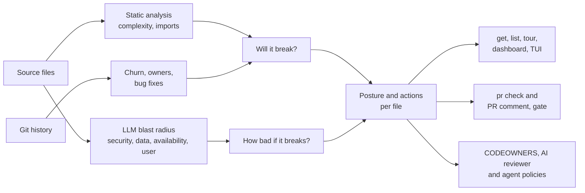

<h1 align="center"></h1>

<p align="center">AI writes code faster than you can review it. See where you're needed and where AI can handle the rest.</p>

<p align="center">
  <a href="https://github.com/zanetworker/highstakes/actions/workflows/ci.yml"></a>
  <a href="https://zanetworker.github.io/highstakes/"></a>
  <a href="LICENSE"></a>
</p>

<p align="center">
  <a href="#install">Install</a> ·
  <a href="#quickstart">Quickstart</a> ·
  <a href="#whats-inside">What's inside</a> ·
  <a href="https://zanetworker.github.io/highstakes/">Docs</a>
</p>

<p align="center">
  
  <br><em>NVIDIA/OpenShell, 1,606 files: red is Harden now, amber Protect, lilac Stabilize, grey Routine. The panel shows what to do before the next merge.</em>
</p>

AI writes code faster than people can review it. HighStakes scores every file in a repo on two questions, *Will it break?* and *How bad if it breaks?*, and turns the answer into concrete steps: who reviews, which tests come first, and where AI agents may merge on their own.

## Install

```sh
go install github.com/zanetworker/highstakes/cmd/highstakes@latest
export OPENROUTER_API_KEY="sk-or-..."   # optional: without it, run analyze --no-llm
```

Needs Go 1.25+ and git.

## Quickstart

```sh
cd /path/to/repo
highstakes init && highstakes analyze
highstakes get internal/llm/sensitive.go
```

```text
internal/llm/sensitive.go
PROTECT
Will it break?         16  LOW   repo cutoff 37
How bad if it breaks?  85  HIGH  repo cutoff 61

Do before the next merge
  [ ] Get an owner's review (@zanetworker)
      why: Protect: costly if it breaks
  [ ] Block auto-merge
      why: Protect files never auto-merge
Put on the backlog
  [ ] Add a CODEOWNERS line
      why: not covered by CODEOWNERS
      /internal/llm/sensitive.go @zanetworker

Why
  Break signals: recent fix: "fix: never send credential files to the LLM; fourth review round" (2026-11-01)
  Break cost: security 85 · data 75; "Missed secrets may be sent to the LLM; false positives omit files."
```

Then `highstakes dashboard` opens the inbox above, and `highstakes` starts the terminal UI.

## Why HighStakes

- **Review where it matters.** Each file gets a posture from its two scores, each shown against the repo's own cutoff: Harden now, Protect, Stabilize or Routine.
- **Every PR gets a to-do list.** `pr check` and the GitHub Action post a checklist, one-click issues and a merge gate that unblocks once the items are done.
- **Know where AI agents may act alone.** Each path gets an autonomy level (auto-merge, auto-fix, propose only, assist only), exported as an agent policy and a task queue.
- **Learn a codebase in the right order.** A reading tour, generated architecture diagrams and runtime units start with the code that matters most.
- **Check it against history.** `check calibration` compares the scores with real fixes, reverts and incidents, and a pinned 7-repo benchmark keeps scoring changes honest.

Use plain CODEOWNERS if you already know your critical paths and only need routing. Use a hotspot tool such as CodeScene if you want years of behavioral history and team dashboards rather than a per-PR checklist.

**What it doesn't do:** it does not review code or find bugs, and it does not run your tests. Scores rank files within one repo, not across repos. *How bad if it breaks?* is AI-assessed and not yet checked against maintainer ratings.

## What's inside

| Area | What you get | Docs |
|---|---|---|
| Scoring | `analyze`: likelihood from churn, complexity, centrality and incidents; impact from an LLM blast-radius read (security, data, availability, user); postures with repo cutoffs; `--no-llm` static mode; results cached by file content | [How it works](docs/how-it-works.md) |
| Look up files | `get <file>` (verdict, checklists, reasons), `list` (filter and sort by tier, impact, likelihood), `report` | [CLI reference](docs/cli-reference.md) |
| See the repo | `dashboard` (action inbox, treemap, explorer, architecture, quadrant), terminal TUI | [Dashboard and TUI](docs/dashboard.md) |
| Understand the code | `get tour` (reading path), `get architecture` (SeeCode diagram or JSON), `list units` (binaries and what they link), `.heatmap/architecture.yaml` for runtime links | [Usage guide](docs/usage.md#tour) |
| Pull requests | `pr check` (verdict, before-merge checklist, worth doing, backlog, reviewers, change risk), `--format markdown` PR comment with one-click issues and a quadrant chart, `--fail-on`, `--strict`, `--shadow` | [CLI reference](docs/cli-reference.md#highstakes-pr-check) |
| CI | `github install` (triage workflow), `pr signoff`, `pr state`, `pr fresh` (sign-off label, live state, stale-run checks), GitLab and other CI | [CI integration](docs/ci-integration.md) |
| Ownership and policy | `create codeowners` (@handles only), `create policy` (no-auto-approve paths for AI reviewers), owner aliases | [Configuration](docs/configuration.md#owner-aliases) |
| AI agents | autonomy levels L3 to L0, `create policy --agents`, `list tasks` (backlog as a work queue), `agent-context` (commands as JSON) | [Agent autonomy](docs/cli-reference.md#agent-autonomy) |
| Is it right? | `check calibration` (holdout, per-signal metrics, security fixes, maintainer labels), `create labels`, multi-repo benchmark | [How it works](docs/how-it-works.md#is-it-right), [bench/](bench/README.md) |
| Incidents | `incident create`, `incident list`: recorded incidents raise likelihood | [CLI reference](docs/cli-reference.md) |
| Configuration | `.heatmap/config.yaml`: excludes, tier thresholds, `autonomy.max_level`, owners, tour settings | [Configuration](docs/configuration.md) |

## How it works



Static and git signals give *Will it break?*; an LLM reads each file for *How bad if it breaks?*. The two scores place the file in a quadrant, and rules turn the quadrant into actions. Details: [How it works](docs/how-it-works.md).

**Models.** One [OpenRouter](https://openrouter.ai) key, any model; the default, `openai/gpt-6-luna`, costs about $0.19 per 500 files, and re-runs only assess changed files. Model comparison: [Configuration](docs/configuration.md).

**What leaves your machine.** Each assessed file's path and first 300 lines go to the model endpoint. Files that look like credentials are never sent, and `--no-llm` sends nothing. See [what is sent](docs/how-it-works.md#what-is-sent-and-what-is-never-sent).

## Contributing

Issues and pull requests are welcome. Build and test with `go build ./... && go test ./... -count=1`; the project layout is in [CLAUDE.md](CLAUDE.md).

## License

[MIT](LICENSE)
