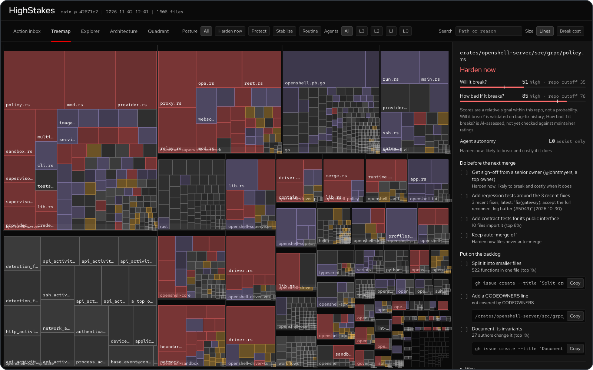
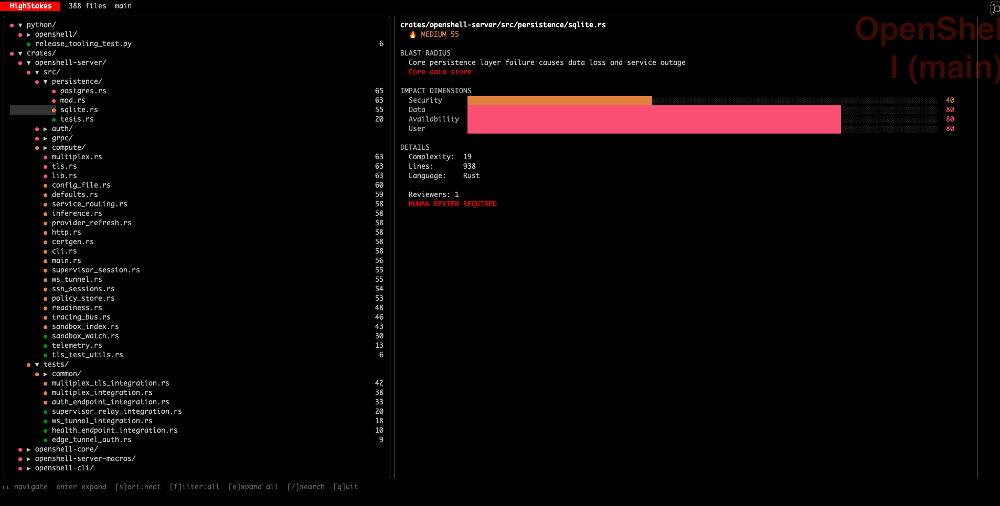
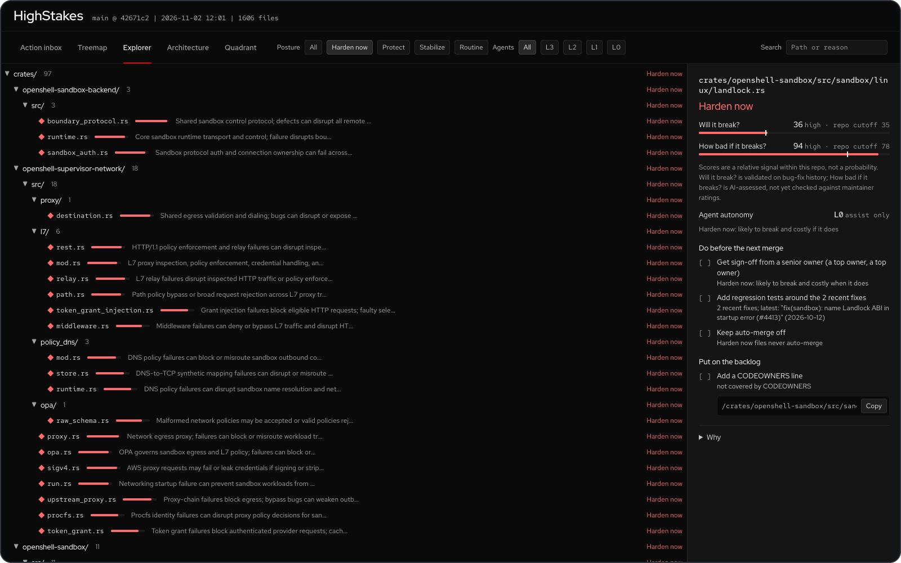

<p align="center">
  <br>
  
  <br>
  <em>AI writes code faster than you can review it. See where you're needed and where AI can handle the rest.</em>
  <br>
  <br>
</p>

<h1 align="center">HighStakes</h1>

<p align="center">
  <strong>Know which code would hurt the most if it broke.</strong>
  <br>
  LLM-assisted blast radius analysis for every file in your repo.
  <br>
  <br>
  <a href="#quick-start">Quick Start</a> ·
  <a href="#how-it-works">How It Works</a> ·
  <a href="#commands">Commands</a> ·
  <a href="#models">Models</a>
</p>

Point it at any codebase. In under 2 minutes, you know:

- **Where to focus**: "sandbox.py handles isolation. Breakage causes container escapes." (score: 73, HIGH)
- **What's safe**: "theme.rs sets terminal colors. Breakage causes cosmetic issues." (score: 6, LOW)
- **What to do**: 2 senior reviewers + security scan, or auto-merge OK

Static analysis alone can't do this. A complexity counter sees `auth.rs` and `theme.rs` as "both Rust files." The LLM reads the code and understands that one is a security boundary and the other formats colors.

## Quick Start

**1.** Install and set up:

```sh
go install github.com/zanetworker/highstakes/cmd/highstakes@latest
export OPENROUTER_API_KEY="sk-or-..."
```

**2.** Analyze:

```sh
cd /path/to/repo
highstakes init && highstakes analyze
```

```
Heatmap generated: .heatmap/heatmap.json (305 files)

Heat Distribution:
  🔥🔥🔥 CRITICAL: 0 files
  🔥🔥  HIGH:     30 files
  🔥   MEDIUM:   141 files
  🟢   LOW:      134 files
```

**3.** See results:

```sh
highstakes dashboard     # Treemap, file explorer and architecture view (opens browser)
highstakes               # Terminal TUI
highstakes list --tier high
```

## Terminal TUI

Navigate the file tree with colored tier indicators. Select any file to see blast radius, impact dimensions, and review requirements.

<p align="center">
  
</p>

## Dashboard

Three views, one detail panel. Click any file to see blast radius reasoning, impact dimensions, and review requirements.

**Treemap** — blocks sized by code volume, colored by heat. Your eye goes to the big red blocks first.

**Explorer** — collapsible file tree sorted hottest-first, with heat bars and reasoning inline.

<p align="center">
  
</p>

All views respond to tier filters (Critical / High / Medium / Low) and search; the treemap also has the size toggle (Lines vs Heat).

**Architecture**: one node per package (directory), laid out in dependency layers: entry points on top, foundations at the bottom. Node size is total lines, color is the most severe tier in the package, and each node names its hottest file. Arrows run from importer to dependency and carry the number of importing files. Click a package to list its files hottest-first in the detail panel, then click a file for its blast radius. Packages outside the current tier filter or search are dimmed.

## How It Works

1. **Static analysis** scans every source file for complexity, dependency centrality, import graph
2. **Git analysis** measures change frequency, contributor count, commit patterns
3. **LLM assessment** sends each file to an LLM: *"if this code has a bug, what breaks?"*
4. **Scoring** combines LLM blast radius (40%) with static signals into a 0-100 heat score
5. **Tiering** maps scores to review requirements

The LLM returns structured scores across four dimensions:

| Dimension | What It Measures |
|-----------|-----------------|
| **Security** | Auth boundaries, crypto, sandbox isolation, access control |
| **Data** | PII handling, persistence, data integrity, schema |
| **Availability** | Service lifecycle, infrastructure, single points of failure |
| **User** | User-facing paths, API contracts, UX-critical flows |

### Scoring Weights

| Factor | Weight | Source |
|--------|--------|--------|
| **LLM Blast Radius** | **40%** | Max of four impact dimensions |
| Dependency Centrality | 15% | Import graph analysis |
| Complexity | 15% | Cyclomatic + cognitive |
| Test Coverage Risk | 10% | Inverse of coverage |
| Incident History | 10% | Manual records |
| Change Frequency | 10% | Git churn |

### Tier System

| Tier | Score | Review Required |
|------|-------|-----------------|
| 🔥🔥🔥 **CRITICAL** | 86-100 | 2 senior reviewers + security scan |
| 🔥🔥 **HIGH** | 61-85 | 2 reviewers + integration tests |
| 🔥 **MEDIUM** | 31-60 | 1 reviewer |
| 🟢 **LOW** | 0-30 | Auto-review safe |

## Commands

### Analyze

```sh
highstakes init                                         # Create .heatmap/ config
highstakes analyze                                      # Full LLM analysis (~$0.15)
highstakes analyze --model z-ai/glm-5.2                 # Different model
highstakes analyze --no-llm                             # Static only, no API key
```

### Visualize

```sh
highstakes dashboard                                    # HTML dashboard (browser)
heatmap                                              # Terminal TUI
```

### Query

```sh
highstakes get <file>                                   # Score + reasoning
highstakes list --tier high --limit 10                  # Filter files
highstakes report                                       # Distribution report
```

All commands support `--json` for machine-readable output.

<details><summary><b>Example: heatmap get</b></summary>

```
$ highstakes get python/openshell/sandbox.py

python/openshell/sandbox.py  🔥🔥 HIGH  (score: 73)

Blast Radius (LLM-assessed):
  Sandbox management and execution failures could compromise
  isolation, leading to security breaches or service outage.
  Reason: Sandbox isolation is a security boundary.
  Security: 95  Data: 90  Availability: 90  User: 90

Risk Factors:
  Dependency Centrality:  8 (1 imports)
  Change Frequency:       0 (0 commits/90d)
  Complexity:             100 (cyclomatic: 53)

Review: 2 reviewers, ~45 min, auto-merge blocked
```

</details>

<details><summary><b>Example: highstakes list --tier high</b></summary>

```
$ highstakes list --tier high --limit 5

🔥🔥  73  python/openshell/sandbox.py       Sandbox isolation breach risk
🔥🔥  72  python/openshell/_proto/...       Import failures in security-critical logic
🔥🔥  69  crates/.../runtime.rs             Host network misconfiguration, VM failures
🔥🔥  67  crates/.../disposition.rs         Corrupted security event values
🔥🔥  65  crates/.../embedded_runtime.rs    Complete loss of VM functionality
```

</details>

### Tour

A risk-ordered reading path for newcomers, auditors and agents. Packages come in dependency order (what everything else imports first), hottest file first within each package. Each stop has a `file:line` anchor at the first top-level declaration, why it matters (LLM critical reason or summary, else static signals), what it depends on, what uses it, and owners from recent commits and annotations. No LLM calls.

```sh
highstakes get tour --limit 10                          # 10 hottest files, dependencies first
highstakes get tour --focus internal/llm                # One directory
highstakes get tour --json > tour.json                  # Feed /show-me walkthrough or an agent
```

<details><summary><b>Example: highstakes get tour --limit 3</b></summary>

```
$ highstakes get tour --limit 3
Tour: 3 stops, dependencies first

1. internal/types  [level 0, max heat 31 MEDIUM]
   1. internal/types/types.go:6  🔥 31 medium
      why: imported by 20 files
      used by: internal/scorer/scorer.go, internal/tour/tour.go, ... (+15 more)

2. internal/scorer  [level 1, max heat 31 MEDIUM]
   2. internal/scorer/scorer.go:12  🔥 31 medium
      why: imported by 5 files
      depends on: internal/types/types.go
      used by: pkg/heatmap/heatmap.go, internal/prscore/prscore.go, cmd/highstakes/main.go, ...

3. internal/tour  [level 1, max heat 28 LOW]
   3. internal/tour/tour.go:34  🟢 28 low
      why: imported by 3 files
      depends on: internal/types/types.go
```

</details>

The tour is a starting draft. Add expert guidance through the `annotations` map in `.heatmap/heatmap.json` (`owner`, `notes`); both appear on each stop.

### PR Risk

```sh
highstakes pr check                                     # Score diff vs main
highstakes pr check --base dev --json                   # For CI pipelines
highstakes pr check --fail-on high                      # Exit 5 on high/critical PRs
highstakes pr check --shadow                            # Log the decision, never fail
```

`pr check` reports two numbers: importance (how hot the touched code is) and change risk (size, new files, config or infra files, deletions in hot files, test ratio). It also names suggested reviewers: the most active recent authors of the hottest changed files, excluding the PR author. See the [CLI reference](docs/cli-reference.md#highstakes-pr-check).

### Review Policy

```sh
highstakes create codeowners                            # Print a CODEOWNERS block for HIGH/CRITICAL paths
highstakes create codeowners --write                    # Update the marked block in .github/CODEOWNERS
highstakes create policy > .github/highstakes-policy.yaml   # No-auto-approve paths for AI reviewers
highstakes create policy --json --min-tier critical
```

Copilot and CodeRabbit can approve PRs, limited by path rules. `create policy` generates those rules from the heatmap so bots stay out of high-stakes code, and `create codeowners` routes the same paths to the people who know them. Map git emails to GitHub handles with the `owners` key in [configuration](docs/configuration.md#owner-aliases).

### Incidents

```sh
highstakes incident create --file src/auth.rs \
  --severity high --description "Token bypass"
highstakes incident list
```

### Calibration

Is the heatmap right? `check calibration` replays git history and compares the scores with what actually broke: reverts, bug-fix commits, security fixes (CVE, GHSA, "security", "vuln") and recorded incidents.

```sh
highstakes check calibration                    # Last 365 days, in-sample
highstakes check calibration --holdout 180d     # Score with history before the cutoff, count events after it
highstakes check calibration --top 20 --json    # Precision/recall for the 20 hottest files
```

It reports the event rate per tier, precision@K and recall@K of the K hottest files, lift over the base rate (1.0 means no better than random), Spearman rank correlation, and the same metrics for blast radius, churn, complexity and centrality alone, so you can see which signal predicts fixes. It also lists surprises: LOW-tier files with many fixes and CRITICAL/HIGH files with none.

Churn comes from the same history as the fixes, so the default run flatters it. Use `--holdout` for an honest number. Blast radius measures impact if broken, not how often code breaks, so a weak correlation for it is expected. See [How It Works](docs/how-it-works.md#is-it-right).

To judge a scoring change across projects and languages, run the pinned multi-repo benchmark in [bench/](bench/README.md).

## CI / PR Integration

Run `highstakes github install` to generate the workflow, or add it manually:

<details><summary><b>GitHub Action: PR triage comments</b></summary>

```yaml
# .github/workflows/heatmap-triage.yml
name: HighStakes Triage
on:
  pull_request:
    types: [opened, synchronize, reopened]

permissions:
  pull-requests: write
  contents: read

jobs:
  triage:
    runs-on: ubuntu-latest
    steps:
      - uses: actions/checkout@v4
        with:
          fetch-depth: 0

      - uses: actions/setup-go@v5
        with:
          go-version: '1.25'

      - name: Install heatmap
        run: go install github.com/zanetworker/highstakes/cmd/highstakes@latest

      - name: Analyze and check PR
        env:
          OPENROUTER_API_KEY: ${{ secrets.OPENROUTER_API_KEY }}
        run: |
          highstakes init
          highstakes analyze
          highstakes pr check --base origin/${{ github.base_ref }} --json > pr-risk.json

      - name: Post risk comment
        uses: actions/github-script@v7
        with:
          script: |
            const risk = JSON.parse(require('fs').readFileSync('pr-risk.json','utf8'));
            const e = {critical:'🔥🔥🔥',high:'🔥🔥',medium:'🔥',low:'🟢'};
            let body = '## '+e[risk.tier]+' HighStakes: '+risk.tier.toUpperCase()+'\n\n';
            body += '| File | Score | Tier | Lines |\n|------|-------|------|-------|\n';
            for (const f of risk.files_changed.sort((a,b)=>b.heat_score-a.heat_score))
              body += '| '+f.path+' | '+f.heat_score+' | '+e[f.tier]+' '+f.tier+' | +'+f.lines_added+'/-'+f.lines_deleted+' |\n';
            body += '\n**Review:** '+risk.review_requirements.min_reviewers+' reviewers';
            if (risk.review_requirements.requires_senior) body += ' (senior)';
            body += ', auto-merge: '+(risk.review_requirements.auto_merge?'✅':'❌')+'\n';
            const comments = await github.rest.issues.listComments({
              owner:context.repo.owner, repo:context.repo.repo, issue_number:context.issue.number});
            const existing = comments.data.find(c=>c.body.includes('HighStakes:'));
            if (existing) await github.rest.issues.updateComment({
              owner:context.repo.owner, repo:context.repo.repo, comment_id:existing.id, body});
            else await github.rest.issues.createComment({
              owner:context.repo.owner, repo:context.repo.repo, issue_number:context.issue.number, body});
```

</details>

<details><summary><b>Block merge on HIGH/CRITICAL files</b></summary>

Add a required status check that fails when the PR touches high-risk files:

```yaml
      - name: Gate on risk tier
        run: |
          TIER=$(jq -r .tier pr-risk.json)
          if [ "$TIER" = "critical" ] || [ "$TIER" = "high" ]; then
            echo "::error::PR touches $TIER-tier files. Requires senior review before merge."
            exit 1
          fi
```

Then in **Settings > Branches > Branch protection rules**, add `triage` as a required status check. PRs touching critical or high files cannot merge until the check passes (i.e., a senior reviewer approves and the step is skipped or overridden).

</details>

<details><summary><b>Use in any CI (GitLab, Jenkins, etc.)</b></summary>

The CLI is the interface. Any CI that can run a binary works:

```sh
# Install
go install github.com/zanetworker/highstakes/cmd/highstakes@latest

# Analyze (uses cache, only re-assesses changed files)
export OPENROUTER_API_KEY="$OPENROUTER_KEY"
highstakes init && highstakes analyze

# Check PR risk (exit code reflects tier)
highstakes pr check --base origin/main --json > risk.json

# Use the output
TIER=$(jq -r .tier risk.json)
SCORE=$(jq -r .heat_score risk.json)
FILES=$(jq -r '.files_changed | length' risk.json)

echo "PR risk: $TIER ($SCORE), $FILES files changed"

# Fail pipeline on high/critical
if [ "$TIER" = "critical" ] || [ "$TIER" = "high" ]; then
  echo "Requires human review"
  exit 1
fi
```

</details>

**What the PR comment looks like:**

```markdown
## 🔥🔥 HighStakes: HIGH

| File | Heat | Tier | Lines |
|------|------|------|-------|
| ⚠️ src/auth/oidc.rs | 63 | 🔥🔥 HIGH | +45/-12 |
| ⚠️ src/sandbox/proxy.rs | 63 | 🔥🔥 HIGH | +8/-3 |
| ✓ src/tui/theme.rs | 6 | 🟢 LOW | +2/-1 |

### ⚠️ Circuit Breaker Signals
- Large diff (>500 lines)

### Review Requirements
- **Reviewers**: 2 (senior)
- **Security Scan**: Required
- **Auto-Merge**: ❌ Blocked
- **Est. Review Time**: 60 min
```

### Agent Introspection

```sh
highstakes agent-context
```

Machine-readable JSON of all commands, flags, exit codes, and models. Built for AI agents to discover the CLI surface programmatically.

## Models

One [OpenRouter](https://openrouter.ai) API key, any model. Assessments cached by content hash; re-runs only re-assess changed files.

| Model | Cost / 500 files | Best For |
|-------|-----------------|----------|
| `openai/gpt-6-luna` | ~$0.19 | Default. Best impact ranking on the benchmark |
| `z-ai/glm-5.3-flash` | ~$0.04 | Cheapest; 2-3x slower |
| `deepseek/deepseek-v4.1-flash` | ~$0.13 | Open weights, can be self-hosted |
| `anthropic/claude-haiku-5.5` | ~$0.19 | Zero failed calls on the benchmark |

Chosen on the [calibration benchmark](bench/README.md) (7 repos, 6,240 files, October 2026): the four models rank files by impact in largely the same order (rank correlation 0.72 to 0.90), so a cheap model is enough. Costs are estimates from token counts.

## Exit Codes

| Code | Meaning |
|------|---------|
| `0` | Success |
| `1` | Internal error |
| `2` | Invalid input |
| `3` | External dependency failure |
| `4` | Not found |
| `5` | PR blocked by `pr check --fail-on` |

## Requirements

- Go 1.25+
- Git
- `OPENROUTER_API_KEY` (optional with `--no-llm`)

## Related

- [Agentic Code Review](https://addyo.substack.com/p/agentic-code-review) by Addy Osmani
- [Semantically-Seeded Impact Analysis](https://arxiv.org/abs/2606.18855) (Jun 2026)
- [BitsAI-CR: Two-Stage Code Review at ByteDance](https://arxiv.org/abs/2501.15134)
- [c-CRAB: Code Review Agent Benchmark](https://arxiv.org/abs/2603.23448)
- [OpenSSF Criticality Score](https://openssf.org/projects/criticality-score/)

## License

MIT
