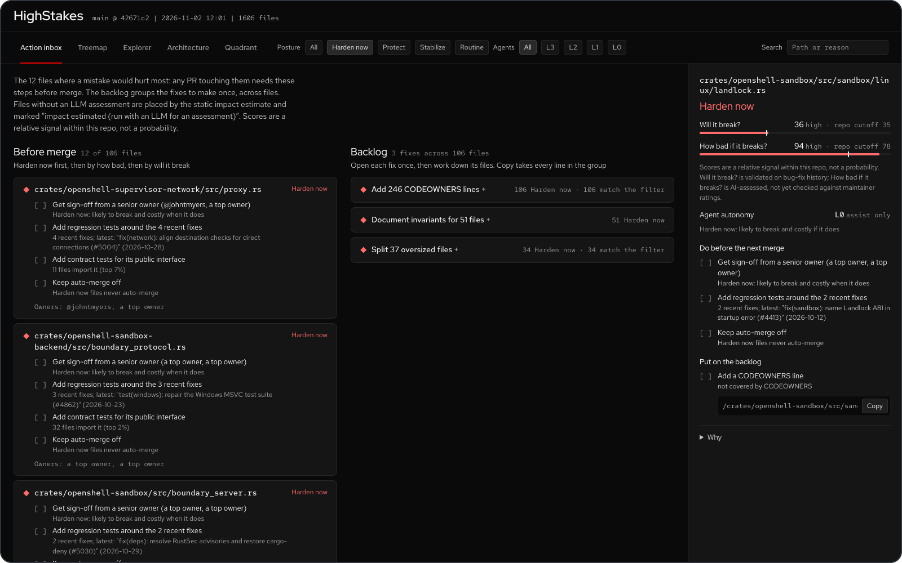
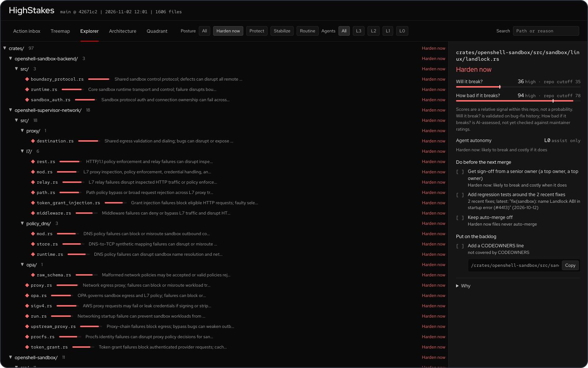

# Dashboard and TUI

## Terminal TUI

Run `highstakes` with no arguments.

Navigate the file tree with colored tier indicators. Select any file to see its posture, both questions, the before-merge and backlog checklists, and the impact dimensions.

## Dashboard

Run `highstakes dashboard`: a self-contained HTML file that opens in the browser.

It opens on the **Action inbox**; four investigation views sit behind tabs. One detail panel: pick a card or a file to see its verdict, both questions with their repo cutoffs (a bar with a tick at the cutoff), the before-merge and backlog checklists, and the reasons folded under **Why**.

**Action inbox**: a plan, not a list. **Before merge** has one card per Harden now or Protect file: its verdict, path, every before-merge step as a checklist (each with the signal that fired it) and its owners, Harden now first, then by how bad, then by will it break. It shows the top 10 (files tied with the tenth stay in) with **Show all** for the rest. **Backlog** has one card per kind of fix across files, such as "Add 248 CODEOWNERS lines" or "Split 37 oversized files", ordered by how many Harden now files each covers. Open a card to see its files and one **Copy** snippet with every line (all CODEOWNERS lines, sorted, or one `gh issue create` command per file). The posture filter and search apply to both. With an LLM, the inbox ranks files by their assessed posture. Without one (`--no-llm`, or no API key), files take the posture their estimated impact falls in against the repo cutoffs, and each such card says "impact estimated (run with an LLM for an assessment)", as does the inbox intro; when a run has both, LLM-assessed files come first. The dashboard is static HTML: it copies commands, it never calls GitHub.

  

**Treemap**: blocks sized by code volume (or break cost), colored by posture. Your eye goes to the big red blocks first.

**Explorer**: collapsible file tree sorted hottest-first, with each file's posture and reasoning inline.

  

All views respond to the posture filter (Harden now / Protect / Stabilize / Routine, one per tier), the **Agents** filter (L3 to L0, the [agent autonomy](cli-reference.md#agent-autonomy) level `analyze` recorded; it filters the inbox too) and search; the treemap also has the size toggle (Lines vs Break cost). The detail panel shows each file's autonomy level, label and reason. Each posture has one colour and one shape everywhere: Harden now a red diamond, Protect an amber triangle, Stabilize a lilac square, Routine a grey circle, so only files that need attention carry colour and the views still read without colour. The URL keeps the open view (`#/arch`, `#/quadrant`, ...).

**Architecture**: one node per package (directory), laid out in dependency layers: entry points on top, foundations at the bottom. It opens grouped by runtime unit when the repo has two or more product units, else by package, fitted to the screen. Node size is total lines, colour and shape are the highest impact in the package (what breaks if it breaks), and a dashed outline with an "N likely" badge marks packages holding files likely to need fixes. Each node names its hottest file. Supporting code (docs, CI, scripts, examples, tests, benchmarks, test data, packages holding only YAML, TOML, JSON or Dockerfiles, helper bins) stays hidden until **Supporting code** is on. To keep the graph readable it draws only the 15 strongest imports plus the strongest import of each critical or high impact node, thin and grey; hover or pick a node to see all of its arrows (with their importing-file counts) while the rest fades, or turn on **All arrows**. Click a package to list its files hottest-first in the detail panel, then click a file for its blast radius. Click an arrow to see the file-level imports behind it (for example `api/src/routes.rs -> core/src/policy.rs`). Packages outside the current tier filter or search are dimmed. Wide layers wrap into rows shaped like the screen; the zoom buttons, **Fit** (whole graph on screen), mouse wheel, trackpad pinch and drag-to-pan handle large repos.

**Group by: Unit** switches the Architecture view from packages to runtime units: one box per deployable entry point (a Rust binary, a Go `main` package, a `package.json` bin or start script, a Python script), holding the components only that unit links, with shared libraries in a band below. Boxes are colored by max impact, carry the fragility marker, and show placement inferred from Dockerfiles, Helm values and Kubernetes manifests. A sandbox runtime and its supervisor built as two binaries show as two boxes, each with the libraries only it links. Click a unit for its entry point, placement evidence, components and files (both questions and posture). Supporting units (examples, scripts, helper bins) stay hidden until **Supporting code** is on, and links declared in `.heatmap/architecture.yaml` draw dashed. Units come from imports and manifests, not from a running system; see [How It Works](how-it-works.md#runtime-units).

**Quadrant**: every file as a dot, "Will it break?" on x and "How bad if it breaks?" on y, with the two repo cutoffs drawn and each quadrant labelled with its posture. Dots are sized by lines and take their posture's colour and shape; hollow dots have an estimated impact (no LLM assessment, also said in the subtitle). The axes zoom to the data, always keeping the cutoffs in view; **Full scale** shows 0 to 100. Files with identical scores are spread a few pixels apart, the same way on every run. The five files that would hurt most (or, without LLM scores, the five most likely to break) are named on the plot. Hover a dot for its path, both scores and posture; click it to open the file in the detail panel.
