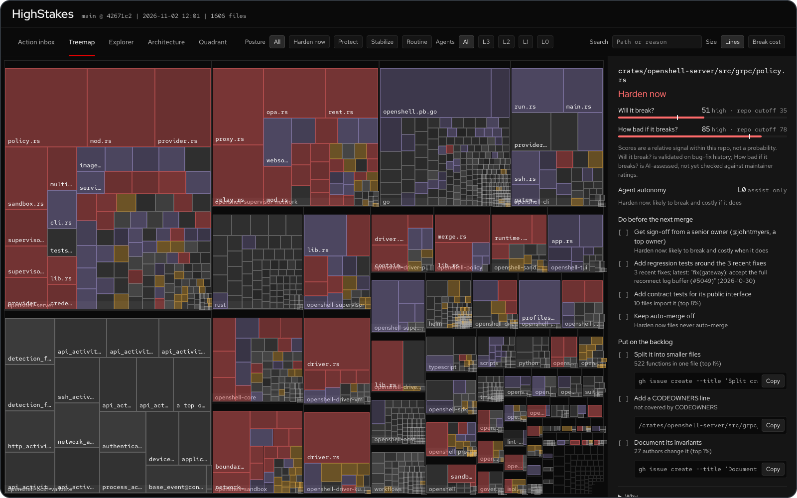
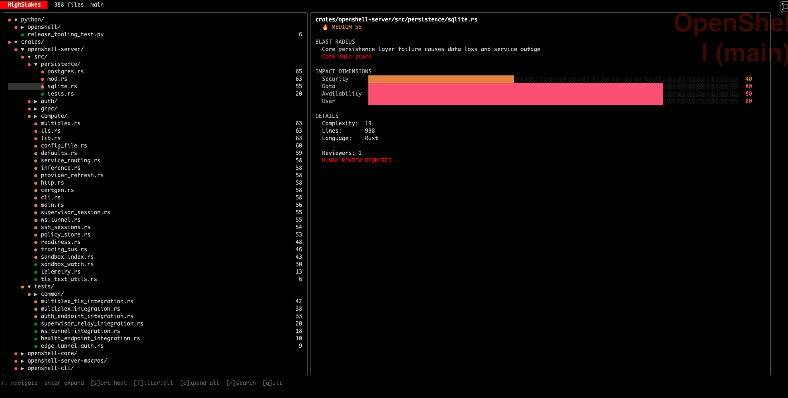

<p style="font-size: 1.3em; color: #666; margin-bottom: 2em;">
Know which code would hurt the most if it broke.
</p>

HighStakes combines static analysis with LLM blast radius assessment to score every file in your repo. It tells you where human review is needed and where AI can handle the rest.



## Quick start

```sh
go install github.com/zanetworker/highstakes/cmd/highstakes@latest
export OPENROUTER_API_KEY="sk-or-..."

cd /path/to/repo
highstakes init && highstakes analyze
highstakes dashboard
```

## How it works

1. **Static analysis** scans complexity, dependency graph, and import structure
2. **Git analysis** measures change frequency and contributor patterns
3. **LLM assessment** reads each file and asks "if this breaks, what's the damage?"
4. **Scoring** gives every file two 0-100 scores: likelihood of needing fixes (churn, complexity) and impact if it breaks (LLM blast radius)
5. **Postures** place each file in the likelihood x impact quadrant and give it actions: what to do before the next merge, and what to put on the backlog

| Posture (tier) | Quadrant | Before merge | Backlog |
|------|-------|--------|--------|
| Harden now (CRITICAL) | Likely and impactful | Senior owner sign-off, regression and contract tests, a smaller PR when the change is large, auto-merge off | Split oversized files, add a CODEOWNERS line, document invariants |
| Protect (HIGH) | Impactful, stable | Owner review, tests when none sit next to the file, contract tests, block auto-merge | Add a CODEOWNERS line, open a test-gap issue |
| Stabilize (MEDIUM) | Likely, low impact | Regression tests when fixes recur, refactor what you touch, a second reviewer for single-owner files; never blocks | Issues to cut complexity or spread ownership |
| Routine (LOW) | Neither | Normal review; agents may auto-merge (autonomy L3) | Nothing |

Likely means the top 20% of the repo by likelihood; impactful means impact in the top 20% of the repo's assessed files, and never below 61. Without an LLM, tiers come from the heat score (86, 61 and 31 thresholds).

## Three ways to see it

**Dashboard** that opens on the **Action inbox** (one before-merge card per Harden now or Protect file, backlog fixes grouped by kind), with treemap, explorer, architecture and quadrant views behind tabs:

```sh
highstakes dashboard
```

**Terminal TUI** with keyboard navigation:



**CLI** with JSON output for CI:

```sh
highstakes list --tier high --json
highstakes get src/auth/oidc.rs
highstakes pr check --base main --json
```

## Works with any model

Any OpenAI-compatible endpoint. No vendor lock-in.

| Setup | Cost | Data stays |
|-------|------|-----------|
| OpenRouter | $0.15/repo | Cloud |
| Self-hosted vLLM on OpenShift AI | Free | On-prem |
| Local Ollama | Free | Your laptop |

```sh
# Cloud
export OPENROUTER_API_KEY="sk-or-..."

# Self-hosted
export HIGHSTAKES_API_KEY="$(oc whoami -t)"
export HIGHSTAKES_API_URL="https://your-model.apps.cluster.dev/v1/chat/completions"

# Local
export HIGHSTAKES_API_KEY="ollama"
export HIGHSTAKES_API_URL="http://localhost:11434/v1/chat/completions"
```

## Documentation

- [Getting started](getting-started.md)
- [Configuration](configuration.md)
- [CI integration](ci-integration.md)
- [CLI reference](cli-reference.md)
- [How it works](how-it-works.md)

## Links

- [GitHub repo](https://github.com/zanetworker/highstakes)
- [Blog post](https://adelzaalouk.me/2026/Jun/27/your-code-review-process-is-already-broken)
